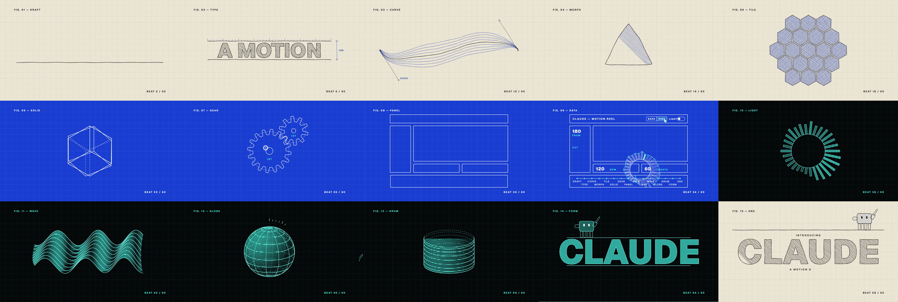

# showreel

A Claude Code skill that turns a subject and a one-line concept into a looping, beat-locked motion design film.

```
/showreel CLAUDE, a motion designer — one pencil line gets promoted three times
```

Claude expands that line into a full beat-by-beat brief and stops for your approval. Then it writes the scenes, renders checkpoint stills and reads them, runs the rule checks, and exports a 1920 x 1080, 60 fps MP4 whose last frame is its first.



The reference film, `claude-motion-designer`: one pencil line drawn on paper, then as wire on a blueprint, then as light on black, over 15 bars at 120 BPM with no cuts.

## Install

```
/plugin marketplace add jmesparteroup/showreel
/plugin install showreel@showreel
```

The first run installs the renderer's dependencies (Playwright with Chromium, opentype.js, a bundled ffmpeg) into the skill's `engine/` folder.

## What you get

```
films/<slug>/
  brief.md        the brief you approved
  scenes.js       film settings and bar dispatch
  shared.js       geometry handed from one bar to the next
  bars/NN.js      one module per bar
  out/<slug>.mp4
  out/stills/     checkpoint PNGs
```

## House rules

Every film follows them, and `check.mjs` enforces the ones a machine can measure:

- A cue on every beat; moves start 0.05 s early so they land on it.
- Critically damped springs (w 12 to 40) and exponential in/out. Nothing overshoots.
- Locked camera. No cuts and no fades: each shot is built from the previous one's geometry.
- Nothing at rest within 150 px of the sides or 90 px of the top and bottom.
- No glows, gradients, particles, shake or holds longer than half a second.
- The last frame is the first.

The full text is in [`house-rules.md`](plugins/showreel/skills/showreel/reference/house-rules.md), and [`brief.md`](plugins/showreel/skills/showreel/examples/claude-motion-designer/brief.md) is the reference brief.

## Engine commands

Run from your project, with `ENGINE` set to the skill's `engine/` folder:

| Command | Does |
|---|---|
| `node ENGINE/new-film.mjs <slug>` | Scaffold `films/<slug>/` |
| `node ENGINE/preview.mjs films/<slug>` | Serve a live preview with a scrubber |
| `node ENGINE/stills.mjs films/<slug> 1.0 2.5` | Write PNG stills at those times (`--bars` for two per bar) |
| `node ENGINE/check.mjs films/<slug>` | Check beats, loop, border, holds and palette |
| `node ENGINE/export.mjs films/<slug>` | Render every frame and encode the MP4 |

Each frame is a pure function of its time: no randomness, no wall clock. That makes stills, checks and parallel export agree exactly.

## Working on this repo

```
npm run setup            # engine dependencies + Chromium
npm test                 # engine unit and pixel tests, reference golden frames
npm run check:example    # rule checks on the reference film
npm run export:example   # render the reference film
```

## Licence

Code is MIT. Geist is by Vercel under the SIL Open Font License; see `plugins/showreel/skills/showreel/fonts/OFL.txt`.
